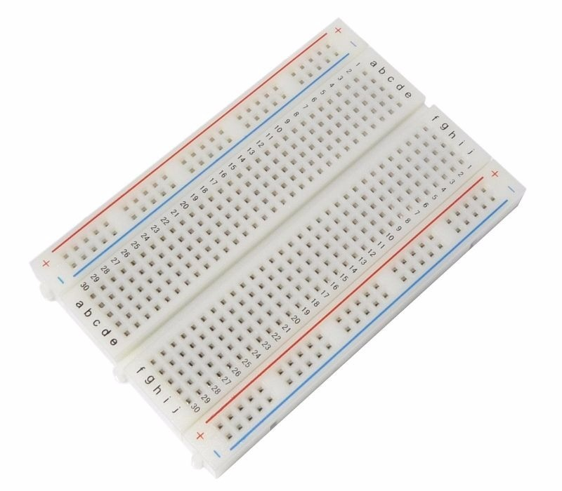
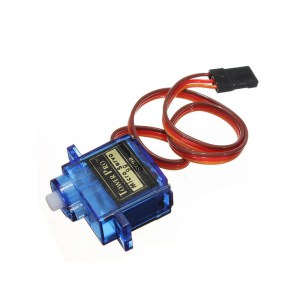
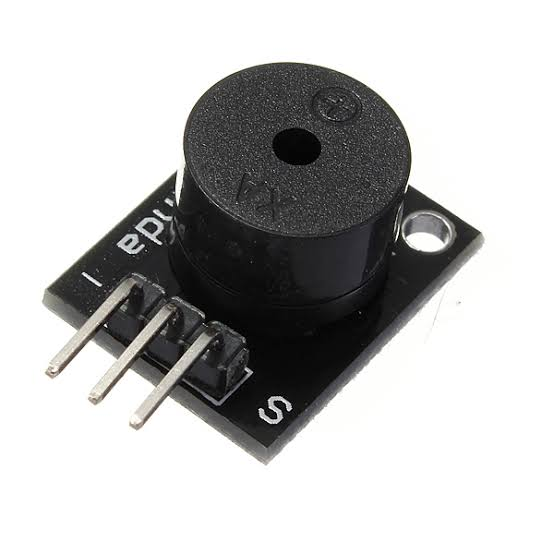
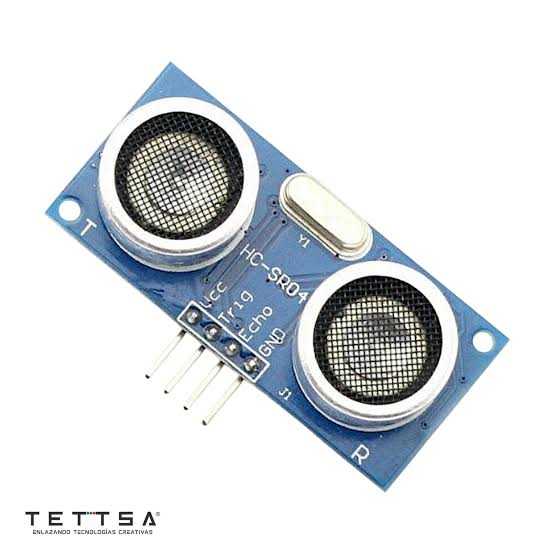
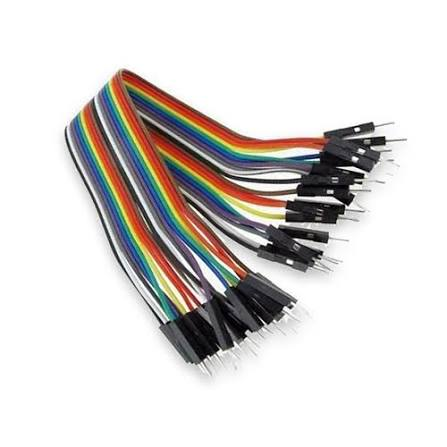
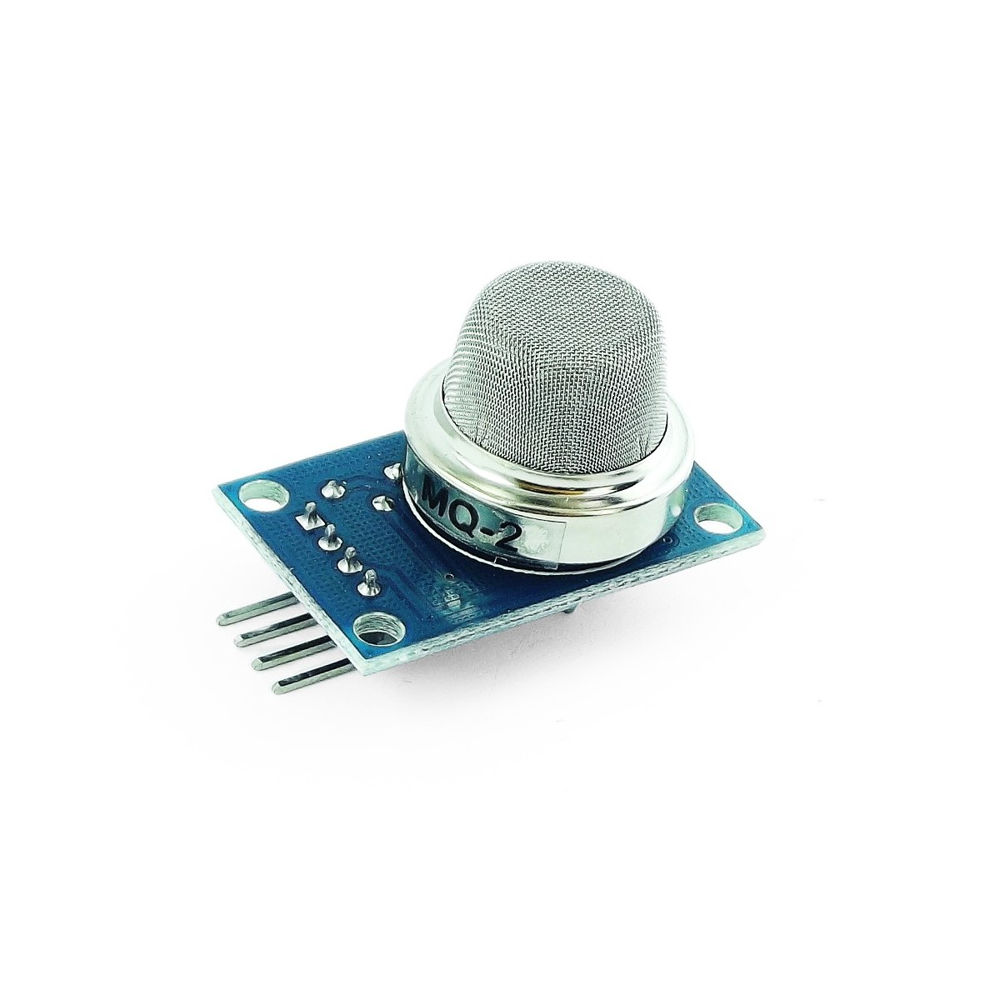

# Documentación Técnica

Fecha: 22 de octubre de 2026

Este documento contiene la documentación técnica para el proyecto STEAM del curso **Laboratorio STEAM+** de la tecnicatura **Redes y Software** del **Instituto Tecnológico de Informática** de **UTU** año 2026.

# Proyecto: [SmartParking]

## 1. Integrantes
- Jim Birriel
- Noemí Dupasus
- Dennis Lemos

## 2. Descripción
- Se trata de un estacionamiento inteligente, donde detecta un vehículo y abre la barrera automáticamente, también tendrá un sensor de gas para la detección de monóxido de carbono, por si un vehículo queda prendido.
- Se brinda la implementación de un parking donde detecta la presencia de Monóxido de Carbono (CO) que es un gas sumamente tóxico y peligroso la acumulación en espacios cerrados, ya que el mismo se considera como un "asfixiante silencioso" porque es tóxico, invisible y sin olor. Por eso es importante la detección en espacios como estacionamientos de shoppings, edificios, etc.

## 3. Materiales

| Imagen       | Descripción |
| ------------ | ----------- |
|  | Arduino uno|
|  | Protoboard |
|  | Servomotor |
|  | Buzzer |
|  | Sensor ultrasónico x2 |
|  | Cables |
|  | Sensor de gas |

## 4. Diseño Mecánico
- [Realizar una descripción de como funciona la solución a nivel mecánico]
- [¿Cómo se arma la solución? Incluir instrucciones de ensamblaje]
  - [Sugerencia: inspirarse en la forma como https://www.instructables.com detalla el armado de un proyecto]
- [Incluir fotografías ilustrativas]

## 5. Diseño Electrónico
- [Realizar una descripción de como funciona la solución a nivel electrónico]
- [Incluir diagramas de Tinkercad mostrando los componentes electrónicos y como van conectados]

## 6. Diseño Software
- [Realizar una descripción de como funciona la solución a nivel de software]
- [Explicar los bloques de código más importantes de la solución programada]
- [Incluir código fuente de python (u otro lenguaje)]
  - [El código debe almacenarse en una carpeta dentro del repositorio]
  - [Sugerencia: almacenar el código en diferentes etapas para mostrar su evolución]

## 7. Referencias y recursos
[Listar referencias, fuentes, recursos, etc usados durante el desarrollo del proyecto]

## 8. Otros
[Incluir cualquier otra información que consideren relevante para el proyecto]

## Nota
En este enlace encontrarás un [ejemplo como debe completarse la documentación técnica](documentacion_tecnica_ejemplo.md).
